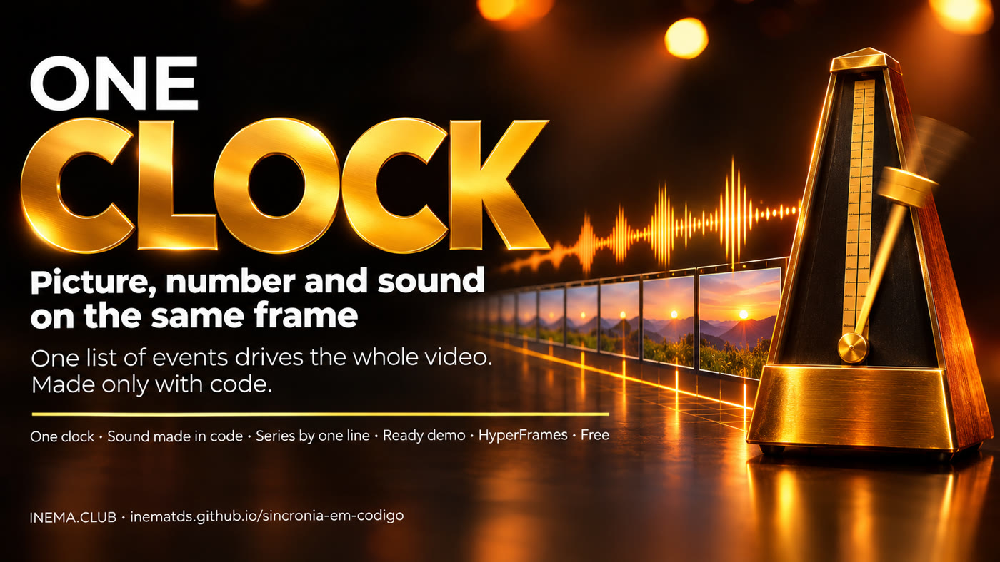

# sincronia-em-codigo — One clock

[](https://linnoff88-dev.github.io/arckhe-/guia/en/)

**🇧🇷 [Português](README.md) · 🇺🇸 [English](README.en.md) · 🇪🇸 [Español](README.es.md)**

## What it is

In video made with code, the most common problem is things getting out of sync: the sound arrives a little early, the number on screen does not match the animation, and each new episode requires changing everything all over again. This kit brings together three ideas that solve this: **one clock** (a list of timed events that the image, counter, and sound all read), **sound made with code** (beats, clicks, and thumps generated on the spot, with no sound effects library), and **a series changed by editing one line** (each episode is a copy of the template where only one file changes). It includes a ready-to-use HyperFrames demo. To use it: Node.js and ffmpeg.

## 📖 User guide

Complete guide (landing page + step-by-step instructions): **https://linnoff88-dev.github.io/arckhe-/guia/en/**

## Get started

```bash
git clone https://github.com/linnoff88-dev/sincronia-em-codigo.git
cd sincronia-em-codigo/exemplo
node ferramentas/som.mjs
npx --yes hyperframes@0.9.37 check
npx --yes hyperframes@0.9.37 render . -o renders/exemplo.mp4 --fps 30
```

## The process, from start to finish

| # | Step | Command | Who |
|---|---|---|---|
| 1 | Write the video's event list | `js/linha.js` with `batidas()` and `relogio()` | 🧠 you or 🤖 agent |
| 2 | Draw based on time | `R.contar(t)`, `R.fase(t)`, `R.desde(t)` in your `tela.js` | 🧠 / 🤖 |
| 3 | Generate sound from the same list | `node ferramentas/som.mjs` | ⚙️ script |
| 4 | Add episodes to the spreadsheet | `serie/episodios.csv` | 🧠 you |
| 5 | Create the episode | `node serie/serie.mjs novo` | ⚙️ script |
| 6 | Render | `npx --yes hyperframes@0.9.37 render . -o renders/ep.mp4` | ⚙️ script |
| 7 | Approve and publish | `node serie/serie.mjs status <slug> aprovado` | 🧠 you |

Bring it to another project: `node copiar-kit.mjs <pasta do projeto>`.

## What's here

| Part | What it does |
|---|---|
| `relogio/relogio.js` | The event list and time queries (`contar`, `fase`, `ultimo`, `proximo`, `desde`, `entre`) |
| `som/sintese.mjs` | Sounds made with code (batida, fatia, estalo, baque, grêo, molhado, plop), mixing, WAV, −15 LUFS |
| `serie/serie.mjs` | Episode per CSV row, with status |
| `exemplo/` | "100 beats" demo in HyperFrames |
| `copiar-kit.mjs` | Copies the clock and sound to `<projeto>/kit/` |

Applied example of the three ideas: [reel-asmr-cortes](https://github.com/linnoff88-dev/reel-asmr-cortes).

MIT License. Fonts (OFL) with the license in `exemplo/fontes/`.