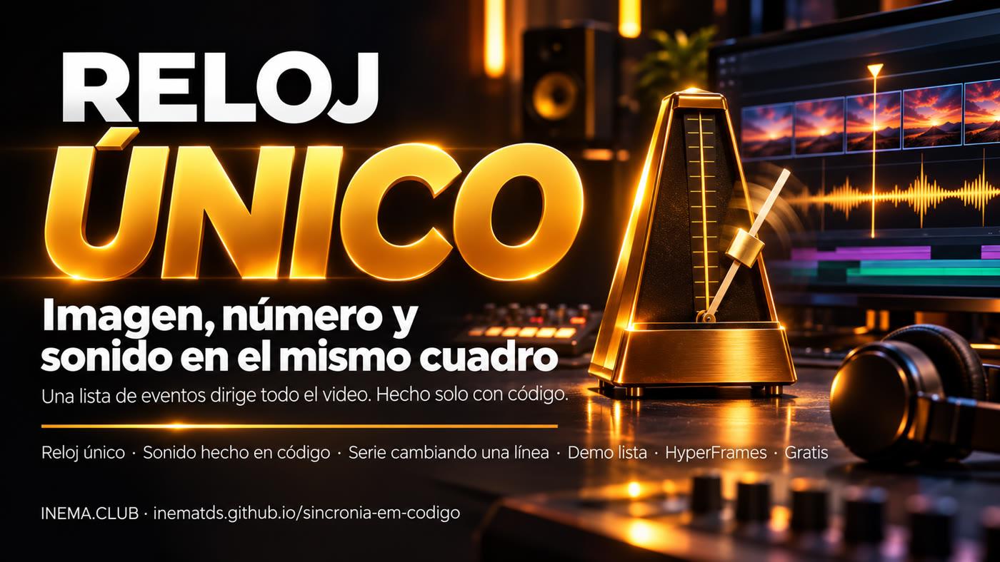

# sincronia-em-codigo — Reloj único

[](https://inematds.github.io/sincronia-em-codigo/guia/es/)

**🇧🇷 [Português](README.md) · 🇺🇸 [English](README.en.md) · 🇪🇸 [Español](README.es.md)**

## Qué es

En un video hecho con código, el problema más común es el desfase: el sonido llega un poco antes, el número en pantalla no coincide con la animación, y cada episodio nuevo obliga a tocar todo otra vez. Este kit junta tres ideas que lo resuelven: **un reloj único** (una lista de eventos con tiempo, que leen la imagen, el contador y el sonido), **sonido hecho en código** (golpes, crujidos y porrazos generados al momento, sin banco de efectos) y **serie cambiando una línea** (cada episodio es una copia de la plantilla en la que solo cambia un archivo). Incluye una demo lista en HyperFrames. Para usarlo: Node.js y ffmpeg.

## 📖 Guía de uso

Guía completa (landing + paso a paso): **https://inematds.github.io/sincronia-em-codigo/guia/es/**

## Empezar

```bash
git clone https://github.com/inematds/sincronia-em-codigo.git
cd sincronia-em-codigo/exemplo
node ferramentas/som.mjs
npx --yes hyperframes@0.9.37 check
npx --yes hyperframes@0.9.37 render . -o renders/exemplo.mp4 --fps 30
```

## El proceso, de principio a fin

| # | Paso | Comando | Quién |
|---|---|---|---|
| 1 | Escribir la lista de eventos del video | `js/linha.js` con `batidas()` y `relogio()` | 🧠 tú o 🤖 agente |
| 2 | Dibujar a partir del tiempo | `R.contar(t)`, `R.fase(t)`, `R.desde(t)` en tu `tela.js` | 🧠 / 🤖 |
| 3 | Generar el sonido de la misma lista | `node ferramentas/som.mjs` | ⚙️ script |
| 4 | Poner episodios en la hoja de cálculo | `serie/episodios.csv` | 🧠 tú |
| 5 | Crear el episodio | `node serie/serie.mjs novo` | ⚙️ script |
| 6 | Render | `npx --yes hyperframes@0.9.37 render . -o renders/ep.mp4` | ⚙️ script |
| 7 | Aprobar y publicar | `node serie/serie.mjs status <slug> aprovado` | 🧠 tú |

Llevarlo a otro proyecto: `node copiar-kit.mjs <pasta do projeto>`.

## Qué hay aquí

| Pieza | Qué hace |
|---|---|
| `relogio/relogio.js` | La lista de eventos y las preguntas sobre el tiempo (`contar`, `fase`, `ultimo`, `proximo`, `desde`, `entre`) |
| `som/sintese.mjs` | Sonidos en código (`batida`, `fatia`, `estalo`, `baque`, `grao`, `molhado`, `plop`), mezcla, WAV, −15 LUFS |
| `serie/serie.mjs` | Un episodio por línea del CSV, con estado |
| `exemplo/` | Demo "100 golpes" en HyperFrames |
| `copiar-kit.mjs` | Copia el reloj y el sonido a `<projeto>/kit/` |

Ejemplo aplicado de las tres ideas: [reel-asmr-cortes](https://github.com/inematds/reel-asmr-cortes).

Licencia MIT. Fuentes (OFL) con la licencia en `exemplo/fontes/`.
